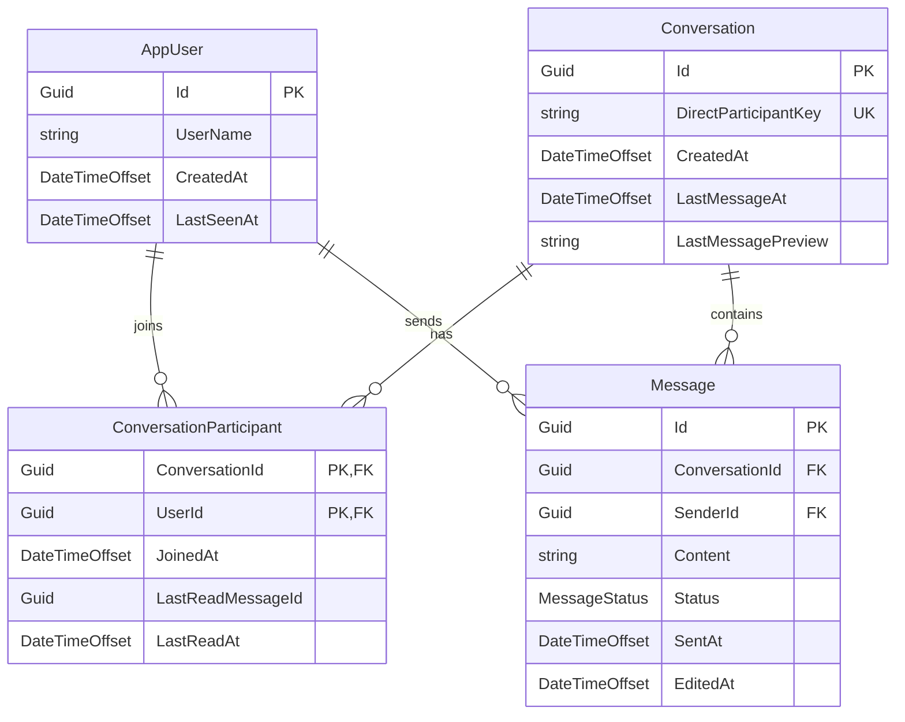

# LetsTalk

A RESTful messaging backend API built with **ASP.NET Core**, **Entity Framework Core**, and **SQLite**, designed with clean separation of concerns, idempotent resource creation, and atomic data consistency.

---

## Tech Stack

* **Framework:** ASP.NET Core Web API (.NET 10)
* **ORM & Data Access:** Entity Framework Core (Code-First Migrations, LINQ Projections)
* **Database:** SQLite
* **API Documentation & Testing:** Swagger / OpenAPI (`Swashbuckle`)
* **Validation:** DataAnnotations & explicit domain invariant guards

---

## Architecture & Key Engineering Decisions

Rather than exposing raw database entities or relying on naive CRUD patterns, **LetsTalk** implements several production-oriented backend patterns:

* **Idempotent 1:1 Conversations (`DirectParticipantKey`):**
  Direct conversations generate a deterministic canonical key by sorting the two participant GUIDs (`minGuid_maxGuid`). A unique constraint combined with a get-or-create flow guarantees that concurrent or repeated requests between the same two users always resolve to a single conversation thread rather than creating duplicates.
* **Denormalized Sidebar Metadata & Atomic Updates:**
  `Conversation` stores `LastMessageAt` and `LastMessagePreview` directly on the parent record. When a message is sent via `POST /api/conversations/{conversationId}/messages`, the API inserts the new `Message` and updates the conversation's preview metadata within a single `SaveChangesAsync()` transaction—eliminating expensive `JOIN` and `MAX()` aggregations when loading a user's inbox list.
* **Strict DTO Boundaries & Read/Write Query Separation:**
  Domain entities (`Domain/Entities`) are never exposed directly over HTTP. Read endpoints use `AsNoTracking()` with `Select(...)` projections directly into immutable C# `record` DTOs to minimize memory overhead, while state-mutating endpoints load tracked entity graphs (`Include` / `ThenInclude`) to enforce participant authorization and persist atomic updates.
* **Relational Join Table for Participants:**
  Users and conversations are linked through an explicit `ConversationParticipant` join entity (`ConversationId`, `UserId`, `JoinedAt`), establishing a clean foundation for future group chats, unread counters, and role-based permissions.

---

## Database Schema



---

## Project Structure

```text
LetsTalk/
├── Controllers/
│   ├── AppUsersController.cs         # User registration & lookup endpoints
│   ├── ConversationsController.cs    # Idempotent conversation creation & inbox queries
│   └── MessagesController.cs         # Message sending & chronological history
├── Domain/
│   ├── Entities/                     # AppUser, Conversation, ConversationParticipant, Message
│   └── Enums/                        # MessageStatus
├── DTOs/
│   ├── Users/                        # User request/response contracts
│   ├── Conversations/                # CreateConversationRequest, ConversationResponse
│   ├── ConversationParticipants/     # ConversationParticipantResponse
│   └── Messages/                     # SendMessageRequest, MessageResponse
├── Persistence/
│   ├── AppDbContext.cs               # EF Core DbContext, fluent constraints & indexes
│   └── Migrations/                   # EF Core schema migrations
└── Program.cs                        # Dependency injection, Swagger & middleware pipeline
```

---

## API Endpoints

### Users
| Method | Endpoint | Description |
| :--- | :--- | :--- |
| `POST` | `/api/users` | Register a new user |
| `GET` | `/api/users/{id:guid}` | Retrieve a user profile by ID |
| `GET` | `/api/users` | Retrieve all registered users ordered alphabetically by username |

### Conversations
| Method | Endpoint | Description |
| :--- | :--- | :--- |
| `POST` | `/api/conversations` | Create a direct conversation or return the existing thread (idempotent) |
| `GET` | `/api/conversations/{id:guid}` | Retrieve conversation metadata and participants by ID |
| `GET` | `/api/conversations?userId={guid}` | Retrieve all conversations for a specific user |

### Messages
| Method | Endpoint | Description |
| :--- | :--- | :--- |
| `POST` | `/api/conversations/{conversationId:guid}/messages` | Validate sender participation, persist a message, and update conversation preview metadata |
| `GET` | `/api/conversations/{conversationId:guid}/messages` | Retrieve chronological message history for a conversation |

---

## Getting Started

### Prerequisites
* [.NET 10 SDK](https://dotnet.microsoft.com/download) (net10.0)
* EF Core CLI tools (`dotnet tool install --global dotnet-ef`)

### Local Setup

1. **Clone the repository**
   ```bash
   git clone https://github.com/emilmukhamediarov/LetsTalk.git
   cd LetsTalk
   ```

2. **Apply Entity Framework Core migrations**
   ```bash
   dotnet ef database update
   ```

3. **Run the application**
   ```bash
   dotnet run
   ```

4. **Explore & test via Swagger UI**
   Open your browser to `https://localhost:<port>/swagger` (or the HTTP URL printed in the terminal) to test the endpoints interactively.

---

## Roadmap

- [x] **Stage 1:** Domain modeling, EF Core schema configuration, composite keys, and SQLite migrations
- [x] **Stage 2:** RESTful API endpoints for Users, Idempotent Direct Conversations, and Messages
- [ ] **Stage 3:** Real-time bi-directional messaging via **ASP.NET Core SignalR** (`ChatHub`)
- [ ] **Stage 4:** Authentication & Authorization using **ASP.NET Core Identity** and **JWT Bearer** tokens
- [ ] **Stage 5:** Automated backend integration tests (`WebApplicationFactory`)
- [ ] **Stage 6:** Windows Desktop client application consuming the REST & SignalR backend (UI framework TBD)